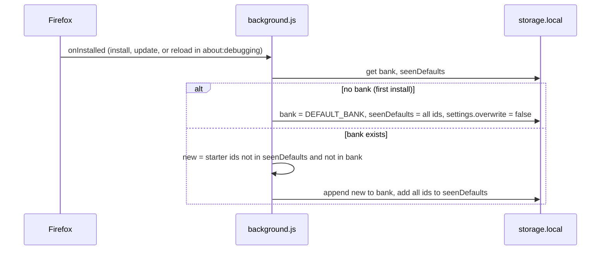
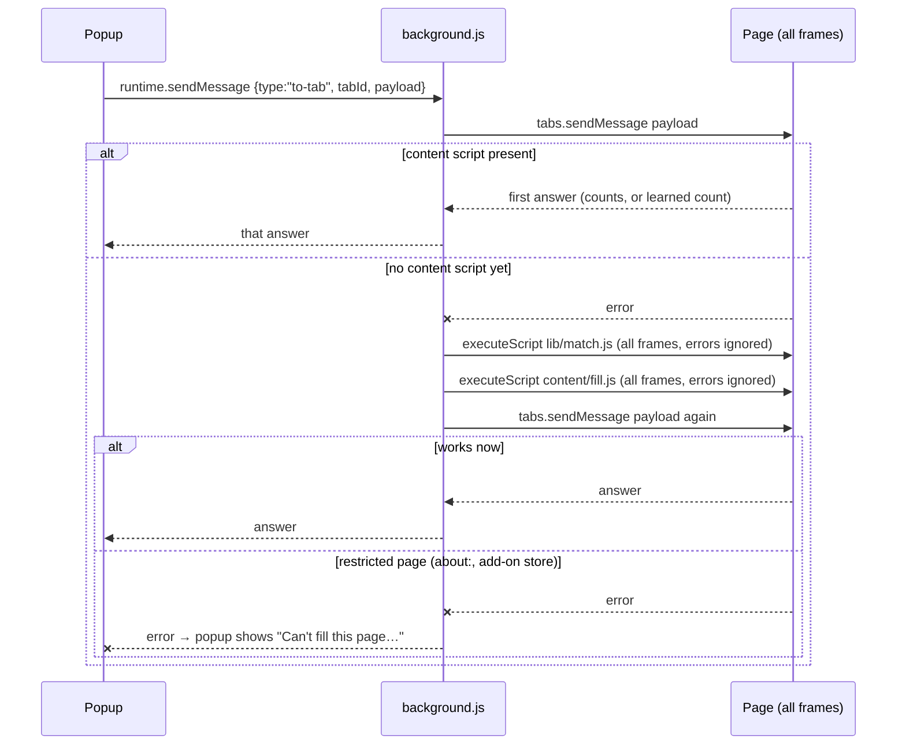
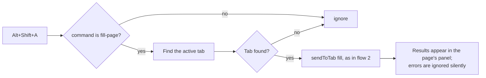

# Extension shell (`background/` + `manifest.json`) — workflows

Line numbers refer to `background/background.js`.

## 1. Install and update (lines 2–14)

Caption: banks from before `seenDefaults` existed use their own ids as "seen", so their missing starter questions (e.g. the Defense section) get added once.

## 2. Fill request from the popup (lines 17–26, 34–36)

## 3. Keyboard shortcut (lines 28–32)

