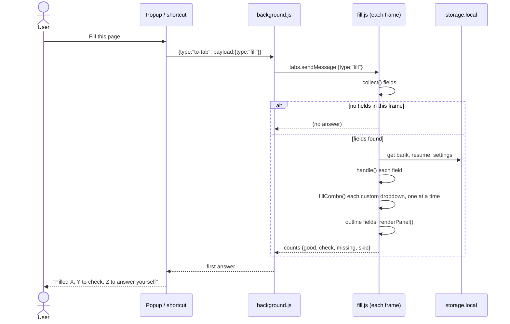
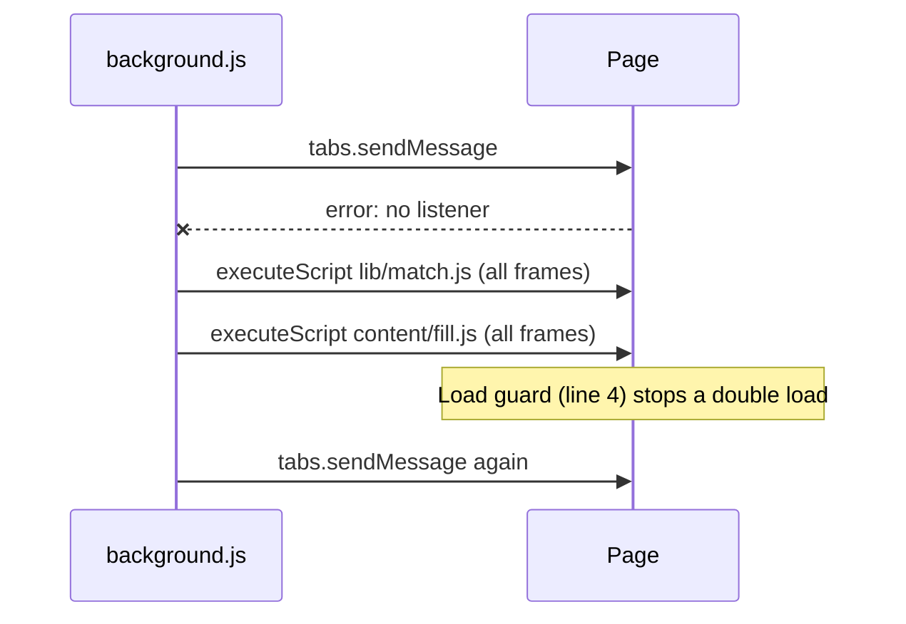
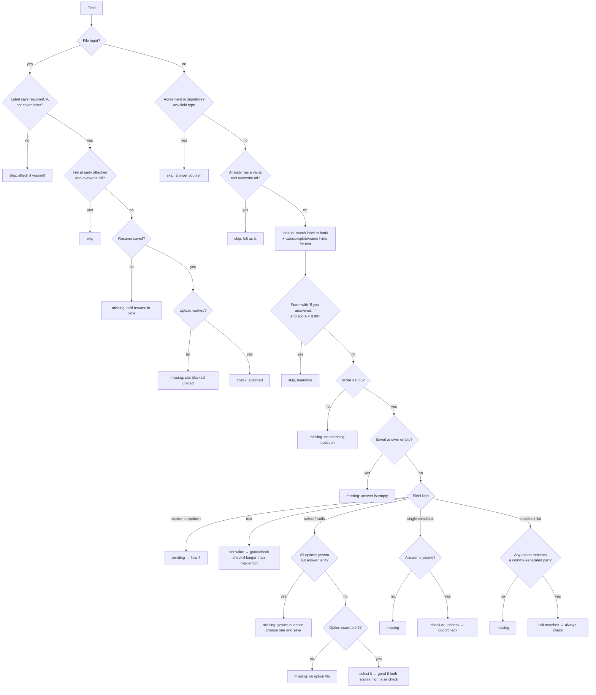
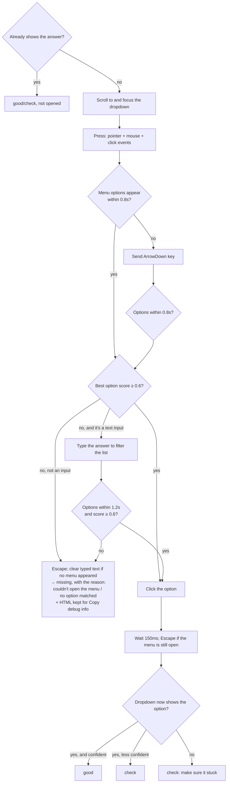
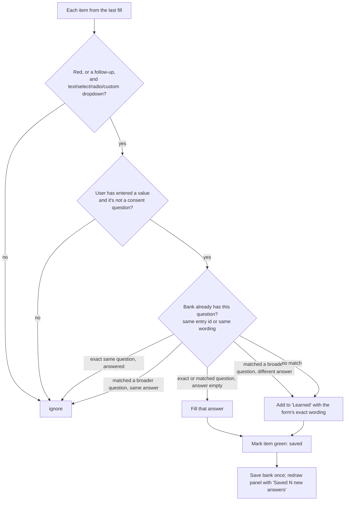

# Form filler — workflows

Line numbers refer to `content/fill.js`.

## 1. Main flow: "Fill this page"

The user clicks **Fill this page** (or presses Alt+Shift+A). Every frame with fields fills itself and draws its own panel. The popup shows the counts from whichever frame answers first.

## 2. Script missing on the page (opened before install, or after a reload)

If the page is a Firefox page or the add-ons store, injection fails and the popup says "Can't fill this page."

## 3. One field: `handle()` decisions (lines 263–347)

Any exception inside `handle()` turns that field into **missing: "Couldn't fill this one automatically"** (line 444). The other fields continue.

## 4. Custom dropdown: `fillCombo()` (lines 198–237)

A dropdown's menu is the element named by its `aria-controls`/`aria-owns`, and only that. Without a named menu, it's a visible `role="listbox"` that appeared after the dropdown was opened (`menuOptions`). Every exit closes the menu (Escape, blur) before the next dropdown starts. Only `role="option"` elements are clicked. If `fillCombo` throws, the field becomes **missing: pick it yourself** (line 449).

## 5. "Save my new answers": `learn()` (lines 471–498)

## 6. Clear highlights / close

The **×** button or **Clear highlights** restores each field's original outline and removes the panel (lines 357–361). Field values stay as filled.
