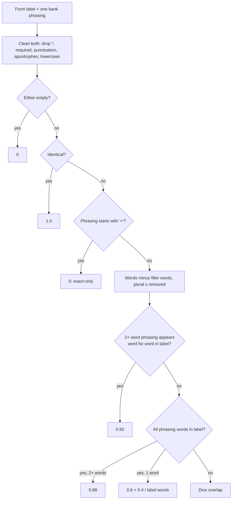
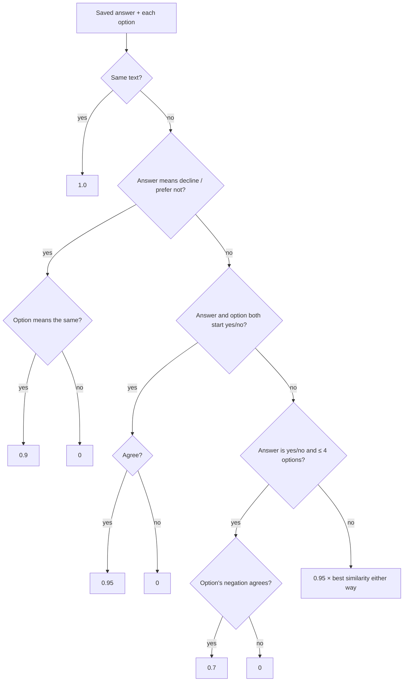
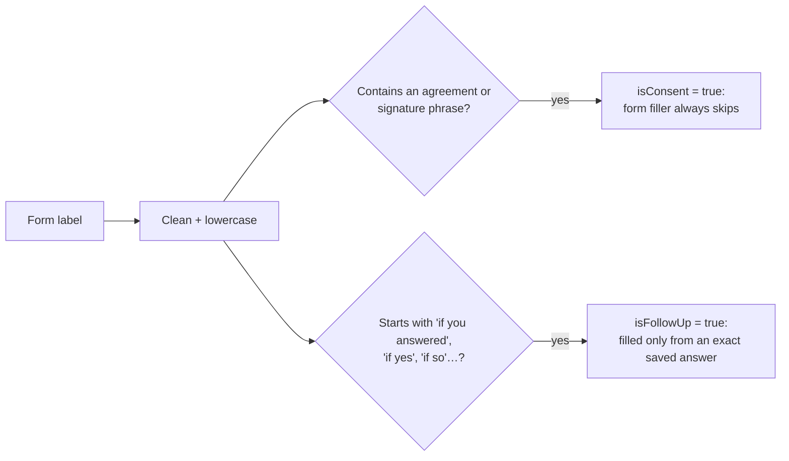
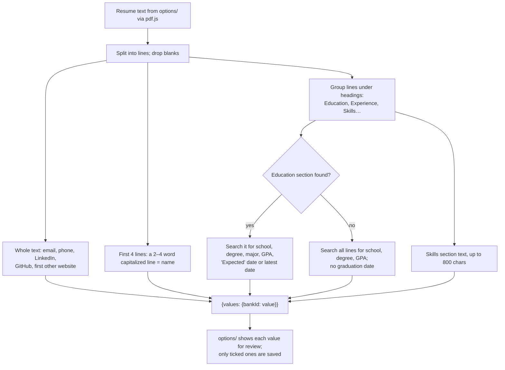
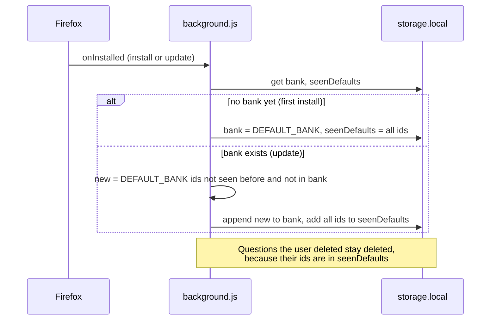

# Shared logic (`lib/`) — workflows

## 1. Matching a form question: `matchQuestion` + `similarity` (match.js:17–52)

For each bank entry, every phrasing (the question plus its other wordings) is scored; the highest score wins. Ties keep the earlier entry.

Caption: the caller (`content/fill.js`) then fills when the best score is ≥ 0.55 (yellow) or ≥ 0.8 (green), and treats an empty answer on the best entry as "answer is empty."

## 2. Picking an option: `pickOption` (match.js:54–79)

Caption: the highest-scoring option wins. The form filler requires ≥ 0.6 to select it, and ≥ 0.85 for green.

## 3. Agreement and follow-up checks (match.js:81–86)

## 4. Resume parsing: `parse` (resume.js:29–95)

Edge cases: an ALL-CAPS name is title-cased; a GPA without a scale is kept as is (e.g. "3.9"); nothing found shows "Nothing recognizable was found" in `options/`.

## 5. Starter questions over time (`defaults.js` + `background/`)

Caption: `options/` also falls back to `DEFAULT_BANK` if it opens before the background script has saved a bank.
