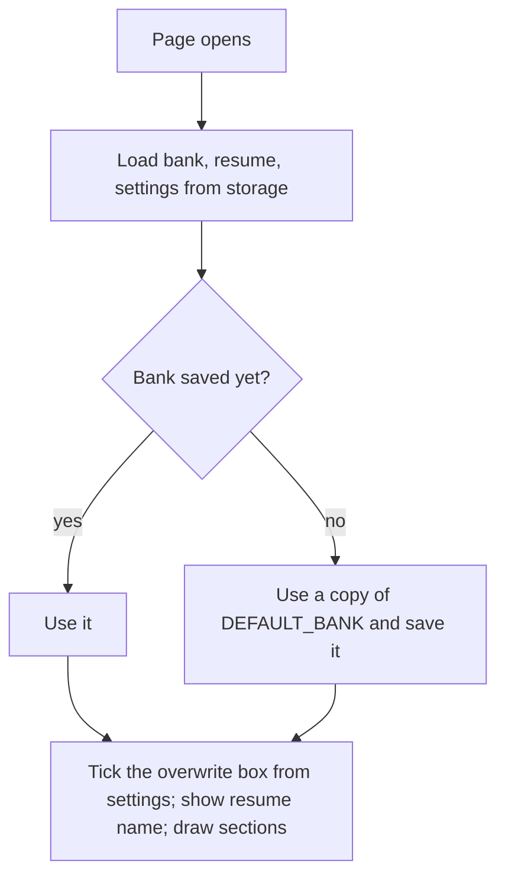
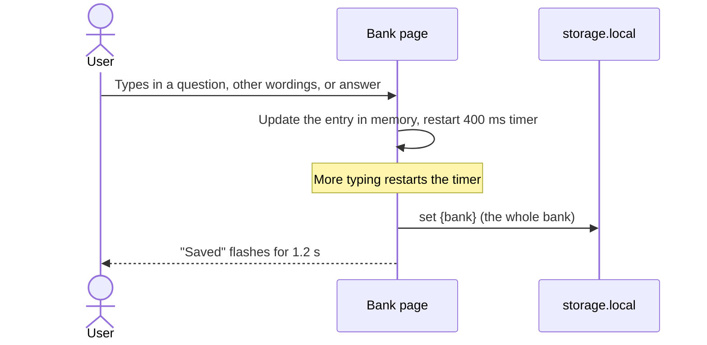
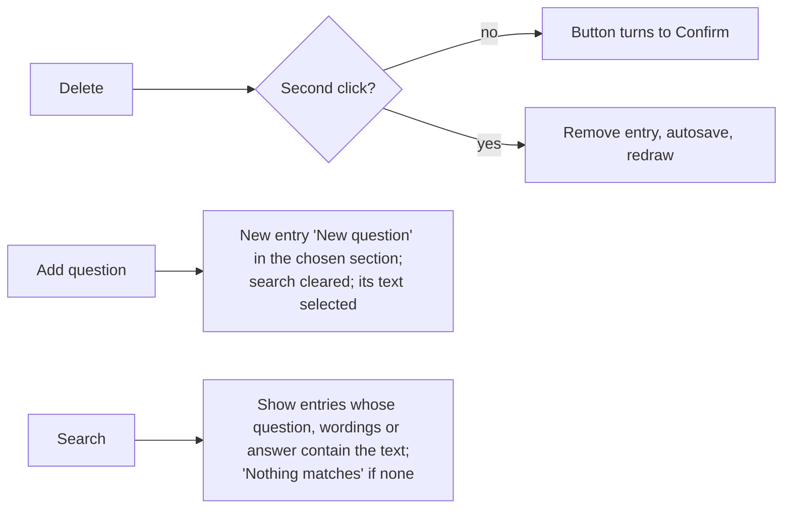
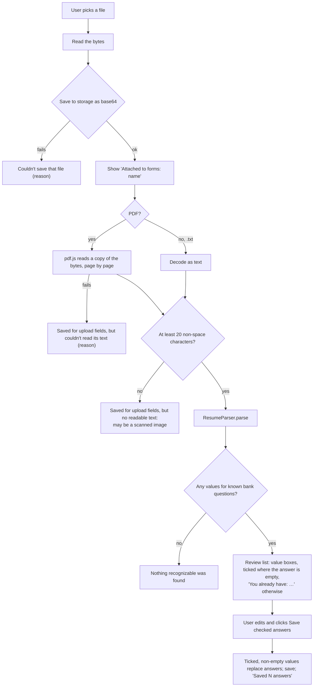
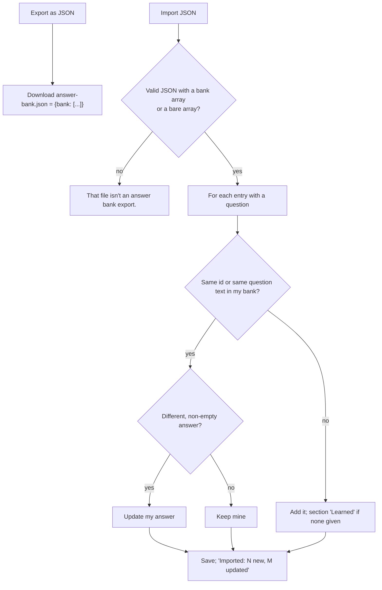

# Answer bank page (`options/`) — workflows

Line numbers refer to `options/options.js`.

## 1. Opening the page (lines 201–207)

## 2. Editing and autosave (lines 23–77)

Branches:

## 3. Resume upload (lines 98–159)

Caption: in every failure after step C, the file is still saved, so upload fields still work.

## 4. Remove resume (lines 165–169)

The **Remove resume** button deletes `resume` from storage and clears the file picker. The form filler then shows "Add your resume…" on upload fields.

## 5. Export and import (lines 171–199)

