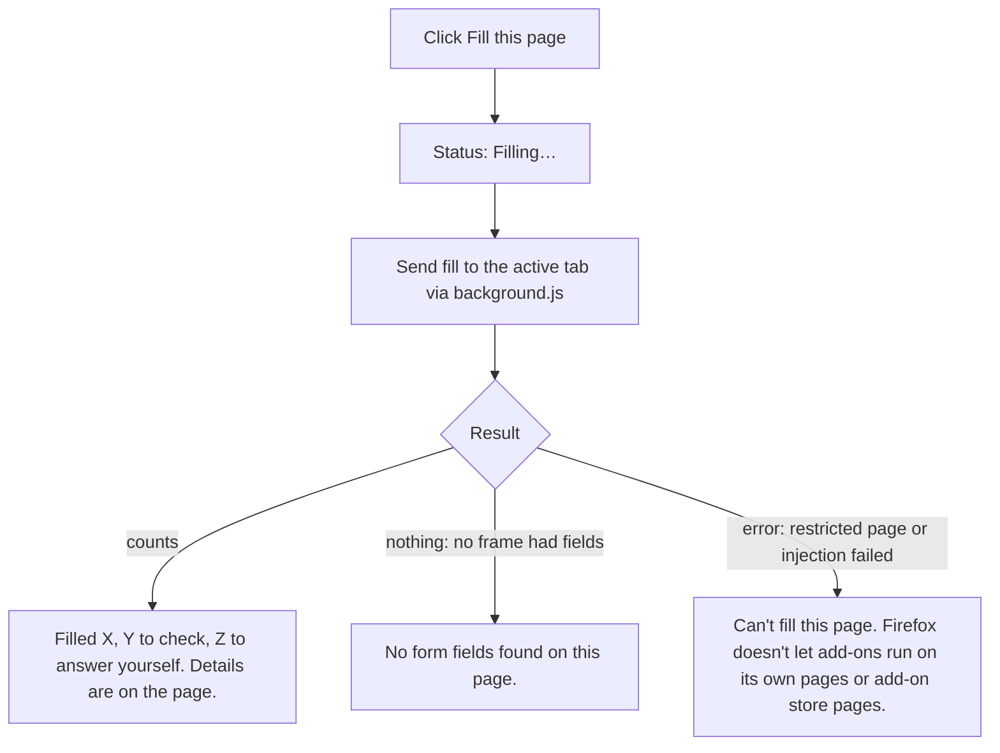
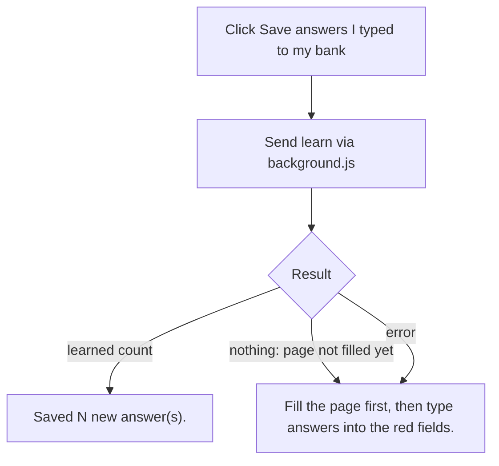
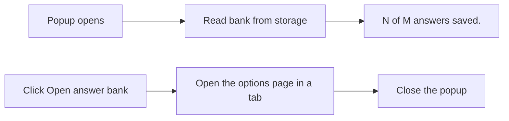

# Toolbar popup (`popup/`) — workflows

Line numbers refer to `popup/popup.js`. The relay and injection steps are in `background/doc/workflow-diagram.md` (flow 2).

## 1. Fill this page (lines 8–18)

## 2. Save answers I typed (lines 20–27)

## 3. Open answer bank and the count line (lines 29–34)

